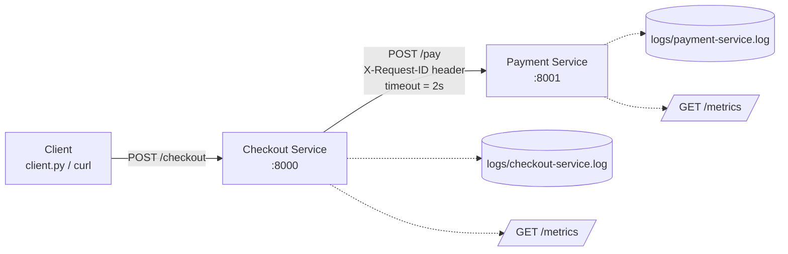
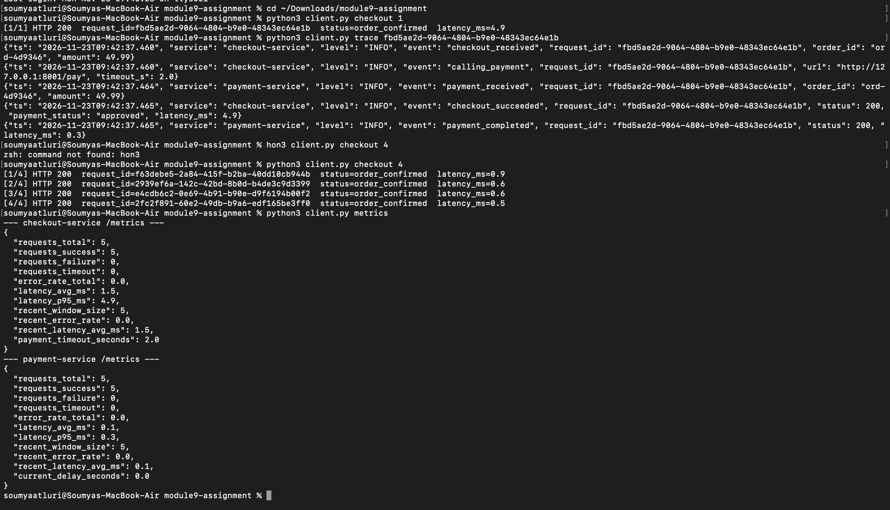
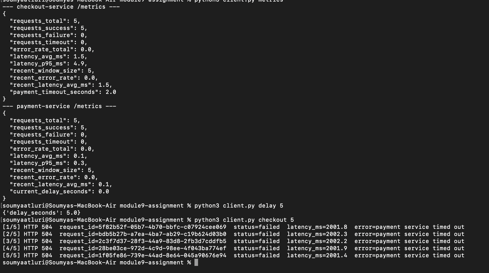
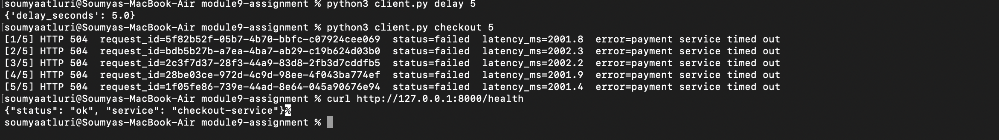
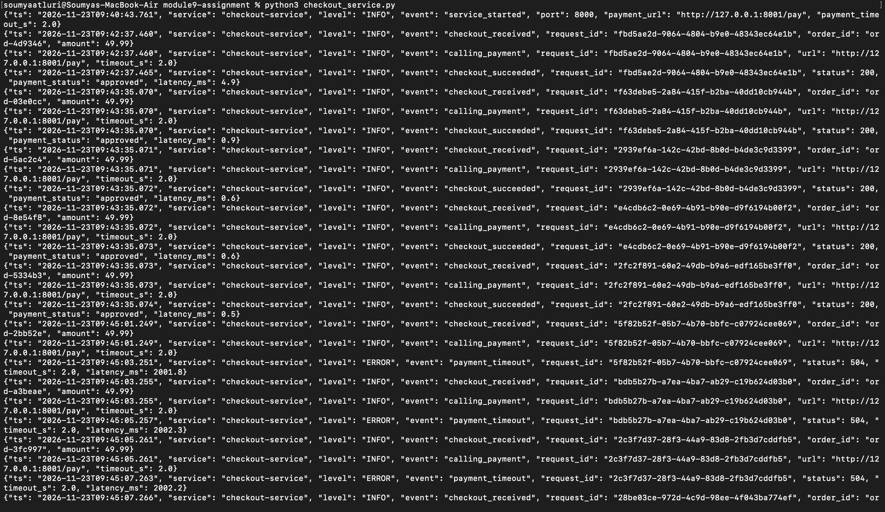
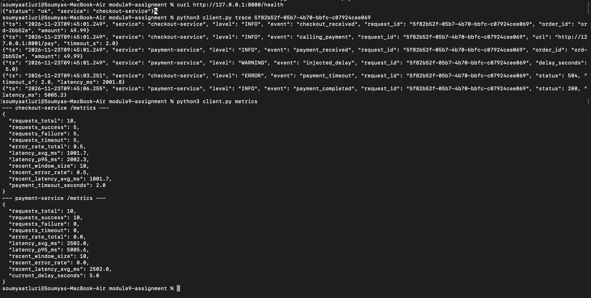
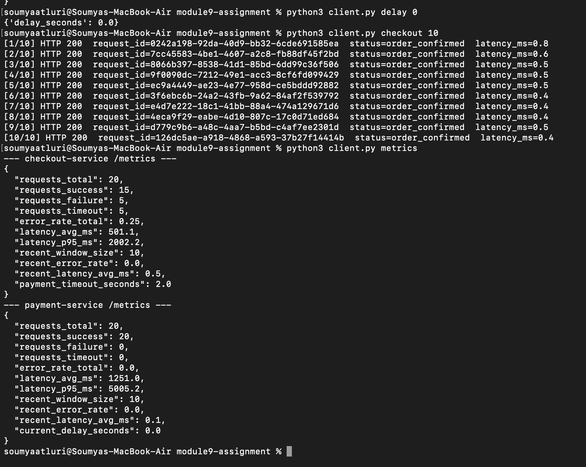

# Module 9 – Fault Tolerance & Observability

Two small Python microservices — **Checkout** and **Payment** — instrumented with
structured logs, latency/success/failure metrics, and a shared **request/trace ID**.
The lab injects a delay into Payment that is longer than Checkout's timeout, shows that
Checkout detects it and stays up, then removes the delay and shows recovery.

* Language: **Python 3.9+**, standard library only (**no `pip install` needed**)
* Checkout → Payment timeout: **2 seconds**
* Injected failure: **5 second** delay in Payment
* Tested on: macOS, Python 3.13

## Architecture



```
 ┌────────┐ POST /checkout ┌──────────────────┐  POST /pay           ┌──────────────────┐
 │ Client │ ─────────────▶ │ Checkout Service │  X-Request-ID: <id>  │ Payment Service  │
 │        │ ◀───────────── │     :8000        │ ───────────────────▶ │     :8001        │
 └────────┘  200 or 504    │ timeout = 2s     │ ◀─────────────────── │ /admin/delay     │
                           └───────┬──────────┘                      └───────┬──────────┘
                                   │ JSON logs + /metrics                    │ JSON logs + /metrics
                                   ▼                                         ▼
                        logs/checkout-service.log                 logs/payment-service.log
```

## Project structure

| File | Purpose |
|---|---|
| `checkout_service.py` | Checkout API (port 8000). Generates the request ID, calls Payment with a 2s timeout, returns `504` on timeout. |
| `payment_service.py` | Payment API (port 8001). Reads `X-Request-ID`, supports an injectable delay via `POST /admin/delay`. |
| `observability.py` | Shared JSON logger and thread-safe metrics (counts, error rate, avg/p95 latency, recent-window stats). |
| `client.py` | Helper: send requests, set the delay, print metrics, trace a request ID across both services. |
| `logs/` | JSON log files written by each service during the run shown below. |
| `screenshots/` | Screenshots of the run. |

## Observability implemented

| Requirement | How |
|---|---|
| Request logs | Every event is a JSON line on stdout **and** in `logs/<service>.log` (`checkout_received`, `calling_payment`, `checkout_succeeded`, `payment_timeout`, `payment_received`, `injected_delay`, `payment_completed`, ...). |
| Request latency | `latency_ms` on each completion log line; `latency_avg_ms`, `latency_p95_ms`, `recent_latency_avg_ms` at `GET /metrics`. |
| Success / failure count | `requests_success`, `requests_failure`, `requests_timeout`, `error_rate_total`, and `recent_error_rate` (last 10 requests) at `GET /metrics`. |
| Shared request / trace ID | Checkout creates a UUID (or reuses the caller's `X-Request-ID`), sends it to Payment in the `X-Request-ID` header, and returns it to the client. Both services log it on every line, and `python3 client.py trace <id>` merges both logs into one timeline. |

## How to run

Requires Python 3.9 or newer (`python3 --version`). Nothing to install.

```bash
git clone <this-repo-url>
cd <repo-folder>
```

**Terminal 1 – Payment Service**
```bash
python3 payment_service.py
```

**Terminal 2 – Checkout Service**
```bash
python3 checkout_service.py
```

**Terminal 3 – Client**
```bash
python3 client.py checkout 1          # 1. one successful request
python3 client.py trace <request_id>  #    follow it across both services
python3 client.py metrics             #    metrics for both services

python3 client.py delay 5             # 2. inject a 5s delay (> 2s timeout)
python3 client.py checkout 5          #    these fail with HTTP 504
curl http://127.0.0.1:8000/health     #    Checkout is still running

python3 client.py delay 0             # 3. remove the delay
python3 client.py checkout 10         #    these succeed again
python3 client.py metrics
```

Equivalent `curl` commands:

```bash
curl -X POST http://127.0.0.1:8000/checkout -H "Content-Type: application/json" -d '{"amount": 49.99}'
curl -X POST http://127.0.0.1:8001/admin/delay -H "Content-Type: application/json" -d '{"seconds": 5}'
curl http://127.0.0.1:8000/metrics
curl http://127.0.0.1:8001/metrics
```

Optional environment variables: `PAYMENT_TIMEOUT` (default `2.0`), `PAYMENT_DELAY` (default `0`),
`CHECKOUT_PORT` (`8000`), `PAYMENT_PORT` (`8001`), `PAYMENT_URL`.

---

## 1. Successful request (Checkout → Payment)

```
$ python3 client.py checkout 1
[1/1] HTTP 200  request_id=fbd5ae2d-9064-4804-b9e0-48343ec64e1b  status=order_confirmed  latency_ms=4.9
```

**The same request followed across both services by its request ID:**

```json
$ python3 client.py trace fbd5ae2d-9064-4804-b9e0-48343ec64e1b
{"ts": "2026-11-23T09:42:37.460", "service": "checkout-service", "level": "INFO", "event": "checkout_received", "request_id": "fbd5ae2d-9064-4804-b9e0-48343ec64e1b", "order_id": "ord-4d9346", "amount": 49.99}
{"ts": "2026-11-23T09:42:37.460", "service": "checkout-service", "level": "INFO", "event": "calling_payment", "request_id": "fbd5ae2d-9064-4804-b9e0-48343ec64e1b", "url": "http://127.0.0.1:8001/pay", "timeout_s": 2.0}
{"ts": "2026-11-23T09:42:37.464", "service": "payment-service", "level": "INFO", "event": "payment_received", "request_id": "fbd5ae2d-9064-4804-b9e0-48343ec64e1b", "order_id": "ord-4d9346", "amount": 49.99}
{"ts": "2026-11-23T09:42:37.465", "service": "checkout-service", "level": "INFO", "event": "checkout_succeeded", "request_id": "fbd5ae2d-9064-4804-b9e0-48343ec64e1b", "status": 200, "payment_status": "approved", "latency_ms": 4.9}
{"ts": "2026-11-23T09:42:37.465", "service": "payment-service", "level": "INFO", "event": "payment_completed", "request_id": "fbd5ae2d-9064-4804-b9e0-48343ec64e1b", "status": 200, "latency_ms": 0.3}
```

**Baseline metrics after 5 successful requests** — 0 failures, 0% error rate, ~1.5 ms average latency:

```
$ python3 client.py metrics
--- checkout-service /metrics ---
{
  "requests_total": 5,
  "requests_success": 5,
  "requests_failure": 0,
  "requests_timeout": 0,
  "error_rate_total": 0.0,
  "latency_avg_ms": 1.5,
  "latency_p95_ms": 4.9,
  "recent_window_size": 5,
  "recent_error_rate": 0.0,
  "recent_latency_avg_ms": 1.5,
  "payment_timeout_seconds": 2.0
}
--- payment-service /metrics ---
{
  "requests_total": 5,
  "requests_success": 5,
  "requests_failure": 0,
  "requests_timeout": 0,
  "error_rate_total": 0.0,
  "latency_avg_ms": 0.1,
  "latency_p95_ms": 0.3,
  "recent_window_size": 5,
  "recent_error_rate": 0.0,
  "recent_latency_avg_ms": 0.1,
  "current_delay_seconds": 0.0
}
```

## 2. Failure test – Payment delay (5s) > Checkout timeout (2s)

```
$ python3 client.py delay 5
{'delay_seconds': 5.0}

$ python3 client.py checkout 5
[1/5] HTTP 504  request_id=5f82b52f-05b7-4b70-bbfc-c07924cee069  status=failed  latency_ms=2001.8  error=payment service timed out
[2/5] HTTP 504  request_id=bdb5b27b-a7ea-4ba7-ab29-c19b624d03b0  status=failed  latency_ms=2002.3  error=payment service timed out
[3/5] HTTP 504  request_id=2c3f7d37-28f3-44a9-83d8-2fb3d7cddfb5  status=failed  latency_ms=2002.2  error=payment service timed out
[4/5] HTTP 504  request_id=28be03ce-972d-4c9d-98ee-4f043ba774ef  status=failed  latency_ms=2001.9  error=payment service timed out
[5/5] HTTP 504  request_id=1f05fe86-739e-44ad-8e64-045a90676e94  status=failed  latency_ms=2001.4  error=payment service timed out

$ curl http://127.0.0.1:8000/health
{"status": "ok", "service": "checkout-service"}
```

* **Checkout detects the timeout** — every request returns `HTTP 504` after ~2000 ms (the timeout), instead of hanging for the full 5 seconds.
* **The service remains running** — `/health` still answers `ok`, and the next requests in Part 3 succeed with no restart.

**Logs show the failed request, followed across both services by its request ID:**

```json
$ python3 client.py trace 5f82b52f-05b7-4b70-bbfc-c07924cee069
{"ts": "2026-11-23T09:45:01.249", "service": "checkout-service", "level": "INFO", "event": "checkout_received", "request_id": "5f82b52f-05b7-4b70-bbfc-c07924cee069", "order_id": "ord-2bb52e", "amount": 49.99}
{"ts": "2026-11-23T09:45:01.249", "service": "checkout-service", "level": "INFO", "event": "calling_payment", "request_id": "5f82b52f-05b7-4b70-bbfc-c07924cee069", "url": "http://127.0.0.1:8001/pay", "timeout_s": 2.0}
{"ts": "2026-11-23T09:45:01.249", "service": "payment-service", "level": "INFO", "event": "payment_received", "request_id": "5f82b52f-05b7-4b70-bbfc-c07924cee069", "order_id": "ord-2bb52e", "amount": 49.99}
{"ts": "2026-11-23T09:45:01.249", "service": "payment-service", "level": "WARNING", "event": "injected_delay", "request_id": "5f82b52f-05b7-4b70-bbfc-c07924cee069", "delay_seconds": 5.0}
{"ts": "2026-11-23T09:45:03.251", "service": "checkout-service", "level": "ERROR", "event": "payment_timeout", "request_id": "5f82b52f-05b7-4b70-bbfc-c07924cee069", "status": 504, "timeout_s": 2.0, "latency_ms": 2001.8}
{"ts": "2026-11-23T09:45:06.255", "service": "payment-service", "level": "INFO", "event": "payment_completed", "request_id": "5f82b52f-05b7-4b70-bbfc-c07924cee069", "status": 200, "latency_ms": 5005.2}
```

Reading the trace:

| Time | Service | What happened |
|---|---|---|
| 09:45:01.249 | checkout | Order received; calls Payment with a 2 s timeout |
| 09:45:01.249 | payment | Request received; **5 s delay injected** |
| 09:45:03.251 | checkout | **ERROR `payment_timeout`** → returns 504 after 2001.8 ms |
| 09:45:06.255 | payment | Finishes after 5005 ms — but Checkout had already given up 3 s earlier |

Note: Payment logged `payment_completed` with status 200, so **Payment's own metrics count all
10 requests as successes while Checkout counts 5 failures**. Payment did work that nobody was
waiting for. Looking at either service alone gives a misleading picture; only the shared request
ID shows that both views describe the same requests.

**Metrics after the failures** — Checkout: 5 failures, 5 timeouts, 50% error rate, average latency up from 1.5 ms to ~1000 ms:

```
$ python3 client.py metrics
--- checkout-service /metrics ---
{
  "requests_total": 10,
  "requests_success": 5,
  "requests_failure": 5,
  "requests_timeout": 5,
  "error_rate_total": 0.5,
  "latency_avg_ms": 1001.7,
  "latency_p95_ms": 2002.3,
  "recent_window_size": 10,
  "recent_error_rate": 0.5,
  "recent_latency_avg_ms": 1001.7,
  "payment_timeout_seconds": 2.0
}
--- payment-service /metrics ---
{
  "requests_total": 10,
  "requests_success": 10,
  "requests_failure": 0,
  "requests_timeout": 0,
  "error_rate_total": 0.0,
  "latency_avg_ms": 2502.0,
  "latency_p95_ms": 5005.6,
  "recent_window_size": 10,
  "recent_error_rate": 0.0,
  "recent_latency_avg_ms": 2502.0,
  "current_delay_seconds": 5.0
}
```

## 3. Recovery – delay removed

```
$ python3 client.py delay 0
$ python3 client.py checkout 10
[1/10] HTTP 200  request_id=0242a198-92da-40d9-bb32-6cde691585ea  status=order_confirmed  latency_ms=0.8
[2/10] HTTP 200  request_id=7cc45583-4be1-4607-a2c8-fb88df45f2bd  status=order_confirmed  latency_ms=0.6
[3/10] HTTP 200  request_id=8066b397-8538-41d1-85bd-6dd99c36f506  status=order_confirmed  latency_ms=0.5
[4/10] HTTP 200  request_id=9f0090dc-7212-49e1-acc3-8cf6fd099429  status=order_confirmed  latency_ms=0.5
[5/10] HTTP 200  request_id=ec9a4449-ae23-4e77-958d-ce5bddd92882  status=order_confirmed  latency_ms=0.5
[6/10] HTTP 200  request_id=3f6ebc6b-24a2-43fb-9a62-84af2f539792  status=order_confirmed  latency_ms=0.4
[7/10] HTTP 200  request_id=e4d7e222-18c1-41bb-88a4-474a129671d6  status=order_confirmed  latency_ms=0.4
[8/10] HTTP 200  request_id=4eca9f29-eabe-4d10-807c-17c0d71ed684  status=order_confirmed  latency_ms=0.4
[9/10] HTTP 200  request_id=d779c9b6-a48c-4aa7-b5bd-c4af7ee2301d  status=order_confirmed  latency_ms=0.5
[10/10] HTTP 200  request_id=126dc5ae-a918-4868-a593-37b27f14414b  status=order_confirmed  latency_ms=0.4
```

**Metrics after recovery:**

```
$ python3 client.py metrics
--- checkout-service /metrics ---
{
  "requests_total": 20,
  "requests_success": 15,
  "requests_failure": 5,
  "requests_timeout": 5,
  "error_rate_total": 0.25,
  "latency_avg_ms": 501.1,
  "latency_p95_ms": 2002.2,
  "recent_window_size": 10,
  "recent_error_rate": 0.0,
  "recent_latency_avg_ms": 0.5,
  "payment_timeout_seconds": 2.0
}
--- payment-service /metrics ---
{
  "requests_total": 20,
  "requests_success": 20,
  "requests_failure": 0,
  "requests_timeout": 0,
  "error_rate_total": 0.0,
  "latency_avg_ms": 1251.0,
  "latency_p95_ms": 5005.2,
  "recent_window_size": 10,
  "recent_error_rate": 0.0,
  "recent_latency_avg_ms": 0.1,
  "current_delay_seconds": 0.0
}
```

### Summary (Checkout Service)

| Metric | Baseline | During failure | After recovery |
|---|---|---|---|
| Requests | 5/5 OK | 5/5 timed out (504) | 10/10 OK |
| `requests_failure` | 0 | 5 | 5 (no new failures) |
| `recent_error_rate` (last 10) | 0.0 | **0.5** | **0.0** |
| `error_rate_total` (lifetime) | 0.0 | 0.5 | 0.25 ↓ |
| `recent_latency_avg_ms` | 1.5 ms | **1001.7 ms** | **0.5 ms** |

* **Requests succeed again** — 10/10 returned `HTTP 200`.
* **Error rate decreases** — recent error rate 0.5 → 0.0; lifetime error rate 0.5 → 0.25 and still falling.
* **Latency returns to normal** — recent average latency 1001.7 ms → 0.5 ms.

## Screenshots

Screenshots taken on macOS while running the lab, in the order they were taken (success → timeout → recovery):













## Reflection

Metrics were the first signal that something was wrong: Checkout's error rate jumped to 50% and
its average latency rose from about 1.5 ms to over 1000 ms, which showed *that* the system was
failing and *when*, but not *where*. Logs explained *what* happened inside each service: Checkout
logged a `payment_timeout` error after 2 seconds, while Payment logged an injected 5-second delay.
The shared request ID tied those separate log streams into one timeline. This mattered because
Payment's own metrics reported 100% success, so looking at Payment alone would have hidden the
problem; the trace showed it was finishing requests Checkout had already given up on. Together,
metrics detect a failure, traces locate it across services, and logs explain the cause, and the same
metrics then confirmed the recovery once the delay was removed.
